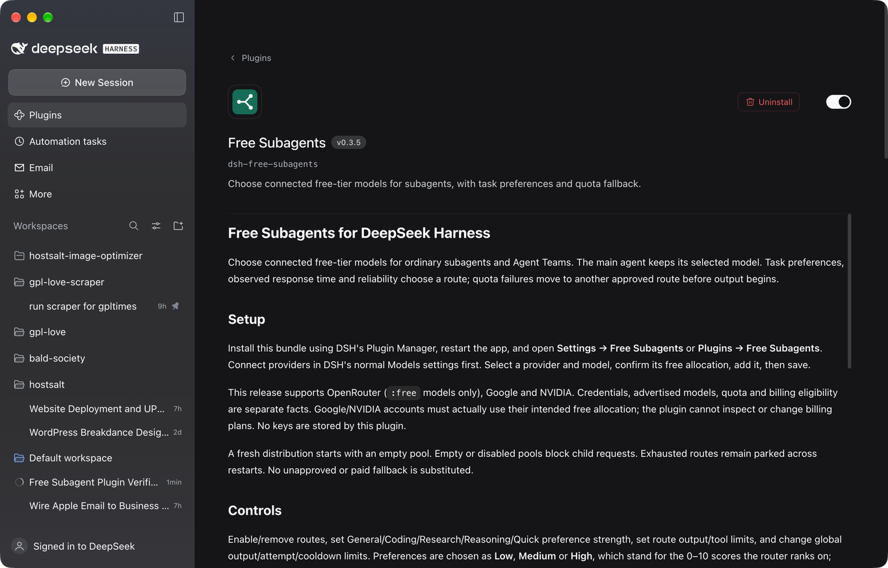

# Free Subagents for DeepSeek Harness

Choose connected free-tier models for ordinary subagents and Agent Teams. The main agent keeps its selected model. Task preferences, observed response time and reliability choose a route; quota failures move to another approved route before output begins.

Routes that rank within one point of each other are treated as interchangeable, and the router rotates through them from one child request to the next. A route the user rates clearly higher always wins the first attempt, and any route can still serve as the fallback when the others are exhausted.

The task is read from the instruction itself. The context the host injects around it — the skill catalogue, the workspace instructions, the runtime and time snapshots — is not part of the task and is ignored, so a child asked to research is not routed as if it were asked to write code.



## Install

```sh
dsh plugin --profile web add dsh-free-subagents
```

The plugin is a normal bundle, so any profile works — `desktop`, `web` or
`headless`. Restart the app, then open **Settings → Free Subagents** or
**Plugins → Free Subagents**. Connect providers in DSH's normal Models settings first. Select a provider and model, confirm its free allocation, add it, then save.

This release supports OpenRouter (`:free` models only), Google and NVIDIA. Credentials, advertised models, quota and billing eligibility are separate facts. Google/NVIDIA accounts must actually use their intended free allocation; the plugin cannot inspect or change billing plans. No keys are stored by this plugin.

A fresh distribution starts with an empty pool. Empty or disabled pools block child requests. Exhausted routes remain parked across restarts. No unapproved or paid fallback is substituted.

## Controls

Enable/remove routes, set General/Coding/Research/Reasoning/Quick preference strength, set route output/tool limits, and change global output/attempt/cooldown limits. Preferences are chosen as **Low**, **Medium** or **High**, which stand for the 0–10 scores the router ranks on; the current bucket is shown pressed. Preferences are heuristics, not model benchmarks. Zero maximum attempts means all eligible routes at most once.

Rating several routes the same for a task puts them in the same rotation tier, so their free allocation is shared instead of one model serving every child. Rate a route lower and it drops out of that tier and becomes a fallback only.

**Reasoning effort** is per route. The selector lists exactly the levels the model declares in DSH's registry, and **Provider default** sends none. A route whose model does not declare the chosen level is skipped rather than called, so an unsupported level can never break a child request. The main agent's own effort never leaks into a route that has none.

The page follows the host theme: route cards, a segmented control per task, toggle switches, status pills and one primary Save action. Save applies to subsequent calls; active calls use their starting settings. Drafts are page-local: save before leaving. Catalog refresh retains drafts. Conflicting edits are rejected; reload saved settings before trying again. User choices are saved by DSH in the profile, independently of package defaults.

## Verified behaviour

Every route in a reference pool was measured against the real providers, with the real profile and the real plugin - latency, reasoning characters, the exact error strings and the ledger parks that follow. The findings, including the three that surprised us (reasoning consumes the output budget, Google's free tier is 20 requests per model per day, and Gemini rejects tool declarations whose name exceeds 128 characters) are in [docs/verification.md](docs/verification.md).

## What this plugin talks to

- **Providers**: OpenRouter (`:free` models only), Google and NVIDIA, through DSH's own model registry and credentials service. This plugin stores no keys and reads no account data.
- **Files**: one local ledger, `~/.dsh/data/free-router-state.json`, holding model identities, cooldowns, approximate counters and timings - no prompts, no answers.
- **Network**: nothing beyond the model providers the pool names.
- **Compatibility**: DSH 0.2.2-rc.1 and later (verified on 0.2.2-rc.2), macOS / Linux / Windows, Node 22+. Preview plugin APIs may change.

## Behavior and privacy

Children select `free-auto/auto` through public agent APIs. Input is never silently truncated. Partial answers are never continued by another model. The routing ledger contains model identities, cooldowns, approximate counters and timings, without prompts or keys. Its default path is `~/.dsh/data/free-router-state.json`. Separate processes share cooldowns; concurrent statistics are approximate.

`npm test` runs offline behavior tests. `npm run status` inspects the local ledger. Integration testing requires a separately supplied DSH runtime; see docs/compatibility.md.

## Compatibility and removal

Test target: DSH 0.2.2-rc.1 and later, verified on 0.2.2-rc.2. Preview plugin APIs may change. This bundle edits no application files or built-in presets. Headless routing has no browser dependency. Some RC Team labels show inherited constructor options; actual child request headers identify the selected virtual model.

Disabling/uninstalling this plugin removes its enforcement and restores DSH's default child model inheritance. Finish active tasks first. Keep user settings and the ledger private. See docs/migration.md and docs/publishing.md.

## Where this plugin is published

- **npm** - [`dsh-free-subagents`](https://www.npmjs.com/package/dsh-free-subagents), the install path above.
- **Plugin market index** - [boldandigital/dsh-plugin-index](https://github.com/boldandigital/dsh-plugin-index), published with GitHub Pages and listed in the harness under **Plugins → Discover → Manage index sources**.
- **dsh-plugin.org** - the community hub finds plugins by the GitHub topic `dsh-plugin`, which this repository carries.
